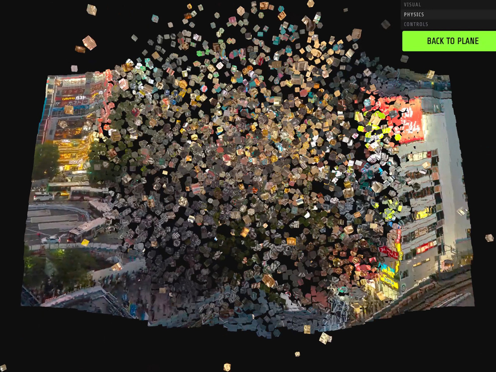

# Pixel-Voxel-Drop-WebGPU

Three.js + Rapier: Video morphing from pixels into voxels, dropping into a physics world



## Installation

Install dependencies:

```
npm install
```

Local server:

```
npm run dev
```

Build:

```
npm run build
```

## Credits

- Shibuya Crossing Video from [pexels.com](https://www.pexels.com/video/timelapse-of-shibuya-crossing-in-tokyo-at-night-32173699/)

## Misc

Follow 1kkaku / Junichi Kasahara: [X](https://x.com/1kkaku0608), [Instagram](https://www.instagram.com/kasahara_junichi_1kkaku/)

## License

[MIT](LICENSE)
